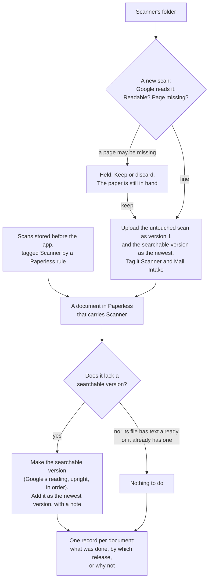

# Design: what the scanner produces, and nothing else

Written 2026-11-23 with release 1.3.0. Narrowed the same day, in 1.3.1, before 1.3.0 was ever installed: the section "Where the app stops" says how and why. Release 1.3.2 removed the three-document limit that 1.3.1 started with. Release 1.4.0 put an explicit job queue at the core (section "The queue"), and renamed the app and its tag. The design went through independent reviews before any of it was built, and the code through more. The last section says what they changed.

The app used to be called Paperless Intake, and its tag used to be called Physical Mail.

Words used here:

- **New scan:** a PDF from the scanner's folder that is not in Paperless yet.
- **Document:** something that is in Paperless.
- **Stored scan:** a document that came out of the scanner. It carries the `Scanner` tag.
- **File version:** Paperless keeps a history of files for each document. Version 1 is the first file. The newest version is the one Paperless shows and searches.
- **Searchable version:** the file the app makes: the same page images turned upright and put in order, with Google's text laid invisibly on top.
- **Release:** a version of the app (1.2.0, 1.4.0).

## What it has to do

- Google is the only thing that reads a scan, with no fallback. Paperless's own OCR does not run: this system has Paperless's OCR mode set to `off`. The app also works with Paperless's defaults, and is tested with them, but that is not how this system runs.
- The app looks after what comes out of the scanner: new scans, and scans stored before the app existed. Nothing else in Paperless is its to touch.
- It knows its own documents by one tag, and by nothing else.
- Each piece of work has one owner. Nothing is done twice, and nothing is missed after a restart or a kill.
- It can be explained with one picture.

## Where the app stops

This is the part to read before changing what the app looks at.

The document system has five steps: scan, ingest, understand, index and query. This app's part is the scan step, plus the ingest check for what the scanner produces: paper becomes a trusted file, handed on as the untouched scan plus its searchable version, tagged `Scanner` (under `Source`), and the app reads both back from Paperless to check they arrived whole. The rest of ingest, and understand, index and query, are not this app's job.

**The `Scanner` tag is the boundary.** It says one thing: this came out of the scanner. The app puts the tag on every scan it uploads. A Paperless workflow put it on the scans that came through Paperless's own consume folder before the app existed. The loop over stored scans takes one on only if it carries the tag.

**The tag is the only test** of whether a stored document is the app's to look after. Jane's rule, decided 2026-11-22: tags represent the truth, and each part of the system knows its documents by tag. The app does not work out from a file's name, its owner or its contents whether a document "is really a scan".

Which half of the app is working on one of its own documents at a given moment is a different question. The app answers that from its own records (see "Who owns a document"), and that is not a second test of what a document is. The `Mail Intake` tag is the same kind of thing as `Scanner`: a tag that states a fact, here "this app uploaded it". The app uses it to find its own uploads: a new scan takes for its own only a document that carries it. A Paperless workflow and the Home Assistant watchdog rely on it too: the workflow skips documents with `Mail Intake`, so the watchdog counts each new scan once.

**A wrong tag is fixed on the document.** A scan without the tag is a gap on that one document. Jane adds the tag in Paperless, and the loop takes the document on at its next look. The gap is never closed by giving the app a second way to recognise scans.

**The app puts `Scanner` (and `Mail Intake`) on the scans it uploads, and never changes a tag on a document already stored.** Someone working on this system who finds a scan without the tag tells Jane, and does not tag documents on their own. And a file is never given the tag as a way to get it read: the tag says the scanner produced it. A tagged file that is not a PDF is set aside for good, with the reason shown on the Scans page.

Why one test and not two. A tag is declared, it shows in Paperless, anything can filter by it, and it can be corrected on a single document. A rule such as "the file is named the way the scanner names files" is a detail of one scanner model. Nobody can see it, and it cannot be corrected for one document. With two tests, everything that touches documents later has to know both and how they disagree. With one, a wrong case is a fix to one document's data.

**What this leaves out, knowingly.** A document without the tag gets nothing from this app: a file added on Paperless's web page, a photo from the phone, an email attachment. With Paperless's OCR off, such a file has search text only if text is already inside it. Jane accepted that on 2026-11-22. The missing tag is how those documents are found. Reading them belongs to the design of that way in, and is not something this app does by default.

Another way in needs answers this app does not have: what the original is (paper in hand, or a file that already exists somewhere), what can be checked before it is stored, what is kept about where it came from, and who reads it when it has no text. The searchable version has only ever been tested on this scanner's pages.

**The tag is checked every time.** The loop checks the tag every time it is about to work on a stored document, before it fetches anything, and once more just before it adds the version, because Google's reading can take minutes. If the tag has been taken off, the app does nothing to the document and lets it go. A let-go document keeps its unfinished work. If the tag comes back, the app takes the document on again and goes on from where it stopped. A document that already has its searchable version stays as it is: nothing works on it again, so taking the tag off changes nothing for it. The app also asks Paperless only for the documents that carry the tag, and checks the tag again on each one Paperless sends.

How it came to this. Release 1.3.0, as merged, looked at every document the app's user could see and judged from the file whether it had been scanned. That reached into kinds of document that do not exist here yet and that the app was never tested on. Jane narrowed it to the scanner. The first attempt at the narrowing then swapped the tag for the scanner's file-name pattern, because one early scan in her Paperless has no tag. That was the wrong fix: the document had a gap, and the rule did not.

## The gap before 1.3

The app only saw the scanner's folder. Scans stored before the app existed, through Paperless's own consume folder, never met it. They carry the text Paperless's own OCR made at the time. With Paperless's OCR now off, nothing would ever read them again, and Google never had.

## The idea: a stored scan can be finished later

A new scan can be checked before it goes into Paperless only on its way in. That matters there because the paper is still in hand.

Once a scan is a document in Paperless, one question is left, and it can be asked at any time, by any release: **does it lack a searchable version?**

The top half is `pipeline.py`. The bottom half is `documents.py`. The scans stored before the app simply start at "A document in Paperless". A document without the tag is not in the picture. What runs when, and what may start at all, is the queue's (`jobs.py`, next section).

## The queue

Jane asked for a job queue from the start. Until 1.4.0 the app had its pieces scattered: one loop over records, a try count here, a wait there. The night of 2026-11-22 showed what was missing. Paperless took up to 18 minutes to take one new file version; the next two uploads timed out at the app's end and landed minutes later; and the app's answer to each timeout was to put that document back for an hour and start the next one at once. While Paperless was struggling, the app kept handing it more work. A queue's scheduler asks "should anything start now?", by looking at what the jobs depend on, and the app never asked.

### Stages and jobs

A scan moves through stages. Each stage can be checked from outside the app: a file, a record, a document or a version in Paperless. A job is the step from one stage to the next.

| | Stage | How it is checked |
| --- | --- | --- |
| New scan | a. a PDF in the capture folder | the file |
| | b. claimed | `items/<sha>/` holds the original and its record |
| | c. checked | the searchable version and `checks.json` exist, or the scan is held for Jane |
| | d. original in Paperless | a document with the scan's checksum and the `Mail Intake` tag |
| | e. searchable | that document has a version with the searchable version's checksum, the note, and it reads back right |
| | f. handed over | `documents/<id>/record.json` exists |
| Stored scan | a. tagged `Scanner` in Paperless, with no record | Paperless's list |
| | b. fetched | version 1 is on disk, with the checksum Paperless has for it |
| | c. built | the searchable version on disk, its checksum in the record |
| | d. version in Paperless | Paperless lists a version with that checksum |
| | e. done | it reads back right, and the note is there |

The jobs: **claim** a→b (in the service), **prepare** b→c and **commit** c→e then f (`pipeline.py`), and **re-read** a→e (`documents.py`). Prepare, commit and re-read run in a worker process, one at a time.

### The records are the queue

There is no second store. A queue library would be one (huey, persist-queue, litequeue and rq were each read for this; none tells "the app was killed" from "this job killed its worker", and huey's SQLite queue deletes a job before running it). A second store has to agree with the records and with Paperless, and a kill between the two writes is the very failure being closed. With the records as the queue, every move is one atomic file write.

What the queue does, and where (`jobs.py`):

- **One job at a time, new scans first**, in the order they arrived. Then stored scans: one cut short, one waiting on a service, one due again, one an earlier release left, a new one from Paperless's list.
- **A lease.** Before a job is handed to a worker, its record is marked with this run of the service. A job found leased by another run was in hand when the app was killed. It is resumed, and that is not a try. Only a worker death that the live service saw (a non-zero exit, a signal) counts against the job. A job that keeps taking the whole app down is stopped after ten restarts that made no step forward; any step forward starts the count again.
- **Tries, waits and dead letters** are each job's own. A new scan waits and retries, and is held for Jane after a day. A stored scan gets 3 tries for faults in the app and 24 hourly tries for outside reasons, then is left for the next release. Held, failed and gave up are the dead letters that need Jane.
- **A rate limit**: the day's Google pages, three quarters of them for stored scans.
- **Backpressure, before a lease**: the gate, below. A job the gate stops is never leased and never blamed.
- **Effects that are safe to repeat**: each step looks before it acts (next part).

### The gate: should anything start now?

Between choosing a job and leasing it, the queue asks, in this order:

1. **An upload whose outcome isn't known** holds every job. Before the app sends Paperless a file, it writes an intent mark (`upload-in-doubt.json`), and it removes the mark once it knows how the upload ended. A mark that is still there means the upload timed out or the app was killed with it in flight. The queue settles it by looking at Paperless, in this order: the file has appeared (by checksum), so it landed; its task has ended, so the job's own rules take over; its task is still unfinished past Paperless's own time limit and 15 minutes more, so it never landed; or, for an upload whose task id was never written down, Paperless has no unfinished consume task made after the mark, five minutes or more after it, so it never landed. Paperless's worker can die while it takes a file in, and Paperless leaves that task unfinished for good: without the time limit, the mark would hold everything for ever. A file that never lands three times sets its job aside, so a file that kills Paperless can't loop. Jane can also forget a mark on the Scans page. If Paperless doesn't answer, the queue asks again later, backing off to half an hour. It never guesses, and it never spins. Paperless's own `/api/status/` is not used: it is not cheap, and it would have said "fine" all through that night.
2. **Memory, disk and stalls** hold every job: less than `min_available_mib` available, less than `min_free_mib` free, or in the last minute at least `max_io_pressure` % of time stalled on disk I/O or `max_memory_pressure` % on memory. With swap full, a shortage of memory is paid as disk I/O, and MemAvailable alone doesn't see it. New scans get the same bars: a scan that starts into a saturated disk makes it worse.
3. **For stored scans only**: a new scan the gate is holding goes first; while a stored scan waits on Paperless or Google, it is the only one that may start, because its own next try is the check that the service is back; and two minutes pass between stored scans, because Paperless goes on working on a version after it has taken it. Discovery (asking Paperless for its list) waits behind the same rules.

A new scan the gate holds back is recorded as a wait (`pipeline.held_back`), two minutes at a time. So its next try, the Scans page and the 24-hour hold stay true. The gate's decision is logged when it changes, not on every pass.

### Killed right after any step: what happens on start

Every step looks first. A kill (power cut, out-of-memory, the Supervisor's stop) can fall anywhere.

| Step | Killed right after it | On start |
| --- | --- | --- |
| Claim: `claim.json` written | the file is still in the capture folder | the folder is removed; the file is claimed again |
| Claim: file moved into `items/` | no `state.json` | the record is written from `claim.json` |
| "started" written as sending | not known whether it went | taken as sent; never sent again |
| Google answered and the answer saved | pages not yet counted | the answer is read from disk; its pages are counted once, by the answer's file |
| Searchable version written | record still says claimed | prepared again from Google's saved answer; nothing paid twice |
| Intent mark written | the upload may or may not have gone | the gate settles the mark first; the step then finds the document by checksum, or uploads |
| Upload sent, task not yet written | the same | the same |
| Task written | Paperless may still be filing it | the step waits for that task |
| Owner cleared, note added | the next step not yet done | each is looked for before it is done again |
| Outcome written with its alert queued | "finished" or the alert not yet sent | sent from the record; "finished" at most once, alerts at least once |
| Outcome written, before the hand-over | no document record | written from the scan's record (`adopt_scans`) |
| Stored scan done, before tidying or closing the scan's alert | working files left, alert open | tidied, and closed |
| Lease written | the job is in hand | resumed; not a try |

Two instants are left open, both outside the app's reach. A webhook can't be asked whether it arrived: the app writes "sending", sends, writes the result, and a kill in between is taken as sent, so "started" and "finished" are never sent twice (a duplicate would leave Home Assistant's counter wrong; a lost one costs one false warning). And a request to Google whose answer was never saved is asked again, which Google may charge twice. Both are a few milliseconds wide. `tests/test_kills.py` kills the app, and separately its worker, at every boundary of a new scan and of a stored scan (each durable write, each call that changes Paperless, each webhook), and checks the end state each time.

## Who owns a document

One rule, so that no document is ever worked on from two sides:

> A document belongs to its new scan until that scan has finished going in and has written the document's record. From then on it belongs to the loop.

How each side keeps to it:

- **The loop** recognises "an unfinished scan is putting this document in" by the file. Paperless's list names the file each document holds, and the loop leaves alone any document whose file belongs to a scan record that has not finished. If Paperless ever failed to name the file, the loop would leave that document alone, because it could not tell.
- **The new scan** takes for its own only a document the app uploaded: one that holds the scan's file and carries the `Mail Intake` tag. The same file stored some other way is somebody else's document. The scan is then uploaded as a document of its own, and Paperless flags the two as duplicates.
- **The hand-over.** The last thing a finished scan does is write the document's record, from what really happened: done, next release (the searchable version reads back badly, or the app could not build one), not needed (almost no text: the only kind a new scan can be), or gave up (Google refused that scan).
- **A scan that failed its read-back** never hands over. It raised its own alert, and its document stays the scan's.

There is no lock file. Home Assistant runs exactly one container for the app, the app is that container's first process, and the queue runs one job at a time.

## How the bottom half works

**One record per document**, in a folder named after the document's id in Paperless. It says what kind of file version 1 is, whether the document has its searchable version, which release last worked on it, and if nothing was done, why. A second file keeps every change of that record. Later steps (dates, people) can add their own lines to the same record.

**One document at a time.** When no new scan is waiting, the queue takes a stored scan, in this order:

1. If a document's work was cut short, finish it.
2. Otherwise one that waits on Paperless or Google, when its hour is up; while one does, nothing else.
3. Otherwise one that is due another try, then one an earlier release left for this one.
4. Otherwise ask Paperless for the documents that carry the `Scanner` tag (at most every five minutes) and take the first one that has no record, or that was let go and carries the tag again. A document without the tag is not even listed: not fetched, not recorded.

Then, for the one taken:

5. Look at its version 1 and decide what work there is. This is about what the file needs, never about whether the document is the app's. The tag has already settled that.
   - **No text inside the file:** what the scanner saves. It needs a searchable version. Tested on the file itself. Paperless's text field is no guide, because for old documents it holds Tesseract's reading.
   - **Text already inside the file:** a scanner set to read pages itself. Recorded as "not needed", for good. The outcomes table below lists the other two kinds.
   - **Not a PDF:** not something the scanner saves, so the tag is probably the mistake. Recorded as "gave up", for good, with the reason.
6. For one with no text inside: Google reads it, the app decides upright and order for the stack, builds the searchable version, adds it to the document, reads it back, writes a note, and records "done".

**If it stops halfway**, it starts that document again from the top and skips what is already done. Each step looks first: is the file here, is the searchable version built, does the document already have it, is the note there. So a step that runs twice does its work once. An outcome that has been written down stands: trouble afterwards, such as a full disk while the working files are removed, cannot turn "done" back into "try again".

**What it may change:** it adds one file version and one note. It adds a version only when every other file version on the document is one the app added itself. So it can improve its own earlier work, and it stays away from a document somebody else has given a file version. It never touches owner, tags, date or title, and it never deletes.

**What it never does for a stored scan:** hold, ask or alert. The document is already stored. A page that looks missing goes into the note.

**Every document ends in one of four outcomes:**

| Outcome | Meaning |
| --- | --- |
| done | It has its searchable version, and Paperless reads it back right |
| not needed | For good. The file has its own text, or almost none, or somebody else added a file version |
| gave up | For good. Google cannot read it, it is not a PDF, or it is gone from Paperless |
| next release | This release could not. The next release of the app tries once |

"Let go" is not an outcome of the work. It is what the record says when the tag is gone, and the document is taken on again if the tag comes back.

**On the way there, something can be in the way:**

- Outside the document (Google or Paperless not answering, or Paperless refusing the app's login): try again in an hour, for up to a day, and start no other stored scan meanwhile. Then "next release".
- The Green short of memory, disk or bandwidth, or an upload still in doubt: the gate holds it before it starts, and nothing is counted.
- The day's Google pages for stored scans are used up: wait for tomorrow (local midnight), and start nothing new until then. This is not a failed try, however long it takes.
- The document itself, or the app (a 500 from Paperless about this document, a version it cannot build, an error nobody planned for, its worker dying): three tries, then "next release". A 404 is "gave up": the document is gone.
- The whole app stopping with the document in hand (a power cut): resumed, not counted. Ten times at the same step, then "next release".

**Each release tries once** what an earlier release left for it. That is the whole of "re-do after an update".

## Where the truth is kept

The documents themselves are the truth. The records are the app's notes about them, and its queue. Three consequences:

1. **The queue is the records.** Each job's state is in its own record, written whole or not at all, and the stages can be checked against Paperless. "Paperless holds a document the app has no record of" is found by asking Paperless, every time.
2. **The loop asks; it does not wait to be told.** A webhook can be missed while the app is down. Asking again finds everything. The cost is a few minutes' delay.
3. **If the app's records were ever lost, finished work would not be done again.** A document whose newest file version carries the app's label already has its searchable version, and the loop records that without asking Google again.

paperless-gpt, the best-known tool for this job, keeps its to-do list as tags inside Paperless, and its issue tracker shows the tags and reality drifting apart. That is the alternative this design avoids.

This does not contradict "the tag is the only test". The two are different kinds of fact. What a document is (`Scanner`: it came out of the scanner) is a tag, put on once when the document is uploaded, and Jane's to correct. What the app has done about a document is work state: it is the app's own record, and it can always be worked out again by asking Paperless. Tags are never used as a to-do list.

## The app's own numbers

The app publishes its state to Home Assistant over MQTT, with device discovery, as the Paperless-ngx Scanner device (`entities.py`, `report.py`, `mqtt.py`; DOCS.md lists the entities). The values are worked out from the records at every publish, never kept as running totals, so they can't drift and are right from the first publish after a start. The network loop and the publisher run in their own threads, so a worker that runs for hours doesn't drop the connection, and nothing about publishing can hold up a job. A worker never loads MQTT. The availability topic has a last will, so a dead app shows as unavailable. The first discovery fixes each entity's id in Home Assistant, so the names were settled before the first release that publishes.

## What this replaced

Before 1.3.0, re-doing a searchable version for a scan that was already stored was handled by flags on the scan's record and a saved snapshot to roll back to: the scan's record was moved backwards through its own states. Most of the defects the code reviews found on 2026-11-22 were in that code. It also only worked while the local scan was kept (7 days).

That code is deleted. The same need is met by the record: "has a searchable version that reads badly" or "has none, and the fault was the app's" means the next release tries again. The file is fetched from Paperless, so the 7-day limit is gone.

Release 1.4.0 removed: counting a cut-short document as a try; the disk check inside the worker (it ran after the job had started, and a full disk then counted as a failed try and let the next document start); treating every Paperless failure, a 404 included, as "try again later"; sending a webhook after the state it is about was saved; and counting Google's pages whenever any part of an answer was new.

## Premortem: a month from now this went badly. Why?

| What went wrong | What prevents it |
| --- | --- |
| The searchable versions were worse than what was there, across 46 documents | Version 1 is never touched, and an added version can be deleted in Paperless. Release 1.3.1 started on three stored scans only. They were looked at in Paperless, and 1.3.2 removed the limit |
| A document got two searchable versions | Before adding, the app asks Paperless whether the document already has that exact file. An upload whose outcome isn't known holds every job until Paperless shows how it ended. The kill tests stop the app at every step and start it again |
| Two parts of the app worked on one document | The ownership rule above, with tests for a scan that is half way in |
| One bad document looped and used up Google pages | Every kind of try is counted and capped. A job that takes the app down is stopped after ten restarts at the same step. Google's answer is kept until the work ends and its pages are counted once. Every try for a stored scan stops at three quarters of the day's page limit, so new scans always have room |
| Real scans were delayed | New scans go first. One job at a time. New scans aren't paced |
| While Paperless struggled, the app kept handing it more work (the night of 2026-11-22) | Nothing starts while an upload is in doubt. A stored scan waiting on Paperless is the only one that may start. Two minutes between stored scans. Uploads wait 10 minutes for an answer |
| A health check said Paperless was fine while it was still taking in late uploads | The gate doesn't ask whether Paperless answers; it asks whether that upload has landed, or Paperless has nothing left to take in |
| Paperless's worker died while taking a file in, its task stayed "started" for good, and nothing ran again | A task unfinished past Paperless's own time limit, and 15 minutes more, counts as never landed. Only tasks made after the mark count. Three times for one file, and its job is set aside. The Scans page can forget the mark at once |
| The Green ran short of memory, or its disk was saturated with swap, while a job ran | The gate checks MemAvailable and the kernel's pressure figures before every job. A kernel without them leaves the memory figure, and the log says so at start |
| The memory or pressure bars were never met, so nothing moved | The reason shows on the Scans page and in Home Assistant (Status, Paused). The bars are options. A new scan held back for a day is held with an alert |
| A scan the gate kept from starting was never held, and never alerted | It is recorded as a wait, so the 24-hour hold and its alert apply |
| A gate after the WORKING mark sent documents to the next release | The gate runs before the lease. A job it stops is never marked |
| A kill sent "started" twice and the watchdog's counter stayed above zero | "started" and "finished" are written as sending before they are sent, and taken as sent after a kill: never twice |
| MQTT broke and took the app with it | Publishing runs in its own threads, is best effort, and is never loaded by a worker. No broker means no numbers, not no scans |
| The connection dropped during a long job, and every entity showed unavailable while work went on | paho's network loop runs in its own thread, so keep-alives go on while the service waits on a worker |
| An entity was renamed and its history split in VictoriaMetrics | The names and ids were fixed before the first publish (`default_entity_id`) |
| The entities drifted from the app's real state | Every value is recomputed from the records at each publish |
| A scan was left out because of how it is filed in Paperless | Two ways. It has no tag: add the tag. It has an owner, which hides it from the app's user: clear the owner or share it. DOCS.md says both. The scans from the consume folder have the tag and no owner |
| A later change gave the app a second way to recognise scans, and the two tests disagreed | "Where the app stops": one test, the tag. A wrong tag is fixed on the document |
| The tag was renamed in Paperless before or after the app, and everything stopped | A missing tag is a wait, never a crash or a counted try. New scans alert once. Everything carries on once the tag is there |
| A Paperless update changed how file versions work | Same rule as for new scans: nothing is written unless Paperless is at a version the tests passed on |
| Jane changed a document while it was being worked on | Her tags, owner and date are never written. A file version she added makes the app leave the document alone. A document that is gone when the app next has reason to look at it is recorded as gone, and nothing else happens |
| The Green ran out of disk | Working files are deleted when a document is finished. (A document that was let go keeps its few working files until its tag comes back.) Each document grows by one file version, roughly its own size again. Nothing starts while free space is under the app's limit |
| A page was missing from a scan stored before the app, and nobody noticed | It is written in the document's note, with no alert. The paper went long ago, so nothing depends on a quick answer |

## What the reviews changed

First review:

- The first draft kept new scans and stored documents as two separate kinds of record and left the old flags in place "for now". The reviewer's main point was that the document should be the unit and the flags should go now. Adopted.
- "Left" meant both "cannot" and "does not need". Split into "not needed" and "gave up".
- A "first three, then press Continue" button was a permanent control for a one-time rollout. Replaced by a limit in one release that the next release removes.
- A lock file was planned. Dropped, for the reason given under "Who owns a document".
- The words "queue", "producer" and "consumer" promised more than was there then. It was one loop and a record per document. (Release 1.4.0 made it a queue: section "The queue".)

Second review:

- The ownership rule had to be written down as one sentence and tested, because a scan that is half way in is exactly where two workers could meet.
- The loop was going to remember the highest document id it had seen. Dropped. Asking for the whole list each time is cheap at this size and cannot skip anything.
- A scan's document record must say what really happened to the scan, not assume "done".
- "Add a version only while the document has exactly one" would have stopped the app improving its own earlier work. Replaced by "only when every other file version is the app's own".

Third review, of the code. Each finding was first reproduced as a failing test:

- Scan records written by releases 1.1.0 to 1.1.2 say "the searchable version could not be built" or "reads back badly" only as a sentence. The hand-over read only the newer fields and would have filed those documents as finished. It now reads both.
- An error after "done" was written (a full disk while tidying) put the document back in line, and it could have been given a second version. A written outcome now stands.
- The three-quarters share of Google pages was only applied to documents the loop had not met. It is now applied in the one place pages are sent, on every try.
- The app dying with a document in hand was not counted, so a document that brought the app down would have done so for ever. It is now bounded (since 1.4.0: ten restarts at the same step, and not counted as a try).
- A new scan whose file was already in Paperless by another route took that document over: cleared its owner, added to it, and replaced the loop's record. A new scan now takes only a document that carries the app's own tag.
- The stand-in for Paperless in the unit tests refused duplicate files, as Paperless did before version 3. It now takes them, as Paperless 3 does. The same case is tested against the real thing.
- A new scan cut short just after its note was written got a second note. It now looks first.
- Six outcomes became four. "Redo", "not yet" and "gave up, the fault was ours" all meant "the next release tries".
- The reviewer then checked the fixes and found three more things, fixed the same way: a scan record that an earlier release had put back from a snapshot still hid "reads back badly"; with the limit lifted, every remaining file would have been fetched on the first day only to wait; and a note written just before an app update was not recognised after it.
- Not adopted: writing the document's record the moment a scan learns its document id. It would not cover the moments before the scan knows that id, which recognising the file does.

After the reviews, before anything was installed:

- The scope was narrowed from every document the app could see to the scanner's documents, known by the tag. None of the three reviews had questioned the wider scope, and neither had the author. Looking at what Paperless actually held settled it: every document there was a scan from this scanner.

For 1.4.0, a draft and a fresh review of it:

- The draft's health check ("ask Paperless's status endpoint") would have passed within minutes on the night it was meant for: the uploads that timed out landed later. Replaced by settling each upload in doubt, and by letting a waiting document's own next try be the check.
- The draft's 800 MiB memory bar would have stopped stored scans almost all the time: the Green's MemAvailable was above 800 MiB 5.5% of one week. 500 MiB, and the kernel's pressure figures, which see a disk saturated by swap.
- Holding a new scan back without recording it as a wait would have silenced its 24-hour hold and alert. It is recorded as a wait.
- A gate placed after the WORKING mark would have counted every wait as a cut-short try. The gate runs before the lease.
- Then the scattered pieces were put together as one queue, with leases, so that being killed is never blamed on the job, and every effect looks before it acts. The kill tests were written to prove it.
