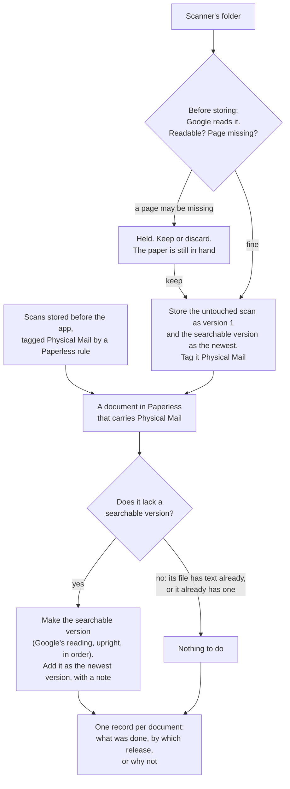

# Design: what the scanner produces, and nothing else

Written 2026-11-23 with release 1.3.0. Narrowed the same day, in 1.3.1, before 1.3.0 was ever installed: the section "Where the app stops" says how and why. The design went through two independent reviews before any of it was built, and the code through a third. The last section says what they changed.

Words used here:

- **Scan:** a PDF from the scanner's folder that is not in Paperless yet.
- **Document:** something that is in Paperless.
- **Stored scan:** a document that came out of the scanner. It carries the `Physical Mail` tag.
- **File version:** Paperless keeps a history of files for each document. Version 1 is the first file. The newest version is the one Paperless shows and searches.
- **Searchable version:** the file the app makes: the same page images turned upright and put in order, with Google's text laid invisibly on top.
- **Release:** a version of the app (1.2.0, 1.3.1).

## What it has to do

- Google is the only thing that reads a scan. Paperless's own OCR does not run.
- The app looks after what comes out of the scanner: scans arriving now, and scans stored before the app existed. Nothing else in Paperless is its to touch.
- It knows its own documents by one tag, and by nothing else.
- Each piece of work has one owner. Nothing is done twice, and nothing is missed after a restart.
- It can be explained with one picture.

## Where the app stops

This is the part to read before changing what the app looks at.

**The `Physical Mail` tag is the boundary.** The app puts the tag on every scan it stores. A Paperless workflow put it on every scan that came through Paperless's own consume folder before the app existed. The loop over stored documents takes one on only if it carries the tag.

**The tag is the only test.** Jane's rule, decided 2026-11-22: tags represent the truth, and each part of the system knows its documents by tag. The app does not work out from a file's name, its owner or its contents whether a document "is really a scan".

**A wrong tag is fixed on the document.** A scan without the tag is a gap on that one document. She adds the tag in Paperless, and the loop takes the document on at its next look. The gap is never closed by giving the app a second way to recognise scans.

Why one test and not two. A tag is declared, it shows in Paperless, anything can filter by it, and it can be corrected on a single document. A rule such as "the file is named the way the scanner names files" is a detail of one scanner model. Nobody can see it, and it cannot be corrected for one document. With two tests, everything that touches documents later has to know both and how they disagree. With one, a wrong case is a fix to one document's data.

**What this leaves out, knowingly.** A document without the tag gets nothing from this app: a file added on Paperless's web page, a photo from the phone, an email attachment. With Paperless's OCR off, such a file has search text only if text is already inside it. Jane accepted that on 2026-11-22. The missing tag is how those documents are found. Reading them belongs to the design of that way in, and is not something this app does by default.

Another way in needs answers this app does not have: what the original is (paper in hand, or a file that already exists somewhere), what can be checked before it is stored, what is kept about where it came from, and who reads it when it has no text. The searchable version has only ever been tested on this scanner's pages.

**One limit of the tag.** The loop looks at the tag when it first meets a document. A document the app already has a record for stays the app's if the tag is taken off later.

How it came to this. Release 1.3.0, as merged, looked at every document the app's user could see and judged from the file whether it had been scanned. That reached into kinds of document that do not exist here yet and that the app was never tested on. Jane narrowed it to the scanner. The first attempt at the narrowing then swapped the tag for the scanner's file-name pattern, because one early scan in her Paperless has no tag. That was the wrong fix: the document had a gap, and the rule did not.

## The gap before 1.3

The app only saw the scanner's folder. Scans stored before the app existed, through Paperless's own consume folder, never met it. They carry the text Paperless's own OCR made at the time. With Paperless's OCR now off, nothing would ever read them again, and Google never had.

## The idea: a stored scan can be finished later

A scan can be checked before it is stored only on its way in. That matters there because the paper is still in hand.

Once a scan is a document in Paperless, one question is left, and it can be asked at any time, by any release: **does it lack a searchable version?**

The top half is `pipeline.py`. The bottom half is `documents.py`. The scans stored before the app simply start at "A document in Paperless". A document without the tag is not in the picture.

## Who owns a document

One rule, so that no document is ever worked on from two sides:

> A document belongs to its scan until that scan has finished going in and has written the document's record. From then on it belongs to the loop.

How each side keeps to it:

- **The loop** recognises "an unfinished scan is putting this document in" by the file. Paperless's list names the file each document holds, and the loop leaves alone any document whose file belongs to a scan record that has not finished. If Paperless ever failed to name the file, the loop would leave that document alone, because it could not tell.
- **The scan** takes for its own only a document the app stored: one that holds the scan's file and carries the `Mail intake` tag. The same file stored some other way is somebody else's document. The scan is then stored as a document of its own, and Paperless flags the two as duplicates.
- **The hand-over.** The last thing a finished scan does is write the document's record, from what really happened: done, next release (the searchable version reads back badly, or the app could not build one), not needed (almost no text), or gave up (Google refused that scan).
- **A scan that failed its read-back** never hands over. It raised its own alert, and its document stays the scan's.

There is no lock file. Home Assistant runs exactly one container for the app, the app is that container's first process, and it works on one thing at a time.

## How the bottom half works

**One record per document**, in a folder named after the document's id in Paperless. It says what kind of file version 1 is, whether the document has its searchable version, which release last worked on it, and if nothing was done, why. A second file keeps every change of that record. Later steps (dates, people) can add their own lines to the same record.

**One loop, one document at a time.** The app already had a single loop that works one scan at a time. When no scan is waiting, the same loop does one round of this:

1. If a document's work was cut short, finish it.
2. Otherwise take one that is due another try, then one an earlier release left for this one.
3. Otherwise ask Paperless for its list of documents (at most every five minutes) and take the first one that carries the `Physical Mail` tag and has no record. A document without the tag is passed over: not fetched, not recorded.
4. Look at its version 1 and decide what work there is. This is about what the file needs, never about whether the document is the app's. The tag has already settled that.
   - **No text inside the file:** what the scanner saves. It needs a searchable version. Tested on the file itself. Paperless's text field is no guide, because for old documents it holds Tesseract's reading.
   - **Text already inside the file:** a scanner set to read pages itself. Recorded as "not needed", for good.
   - **Not a PDF:** a photo that was given the tag. Recorded as "next release". A release that can read images picks these up.
5. For one with no text inside: Google reads it, the app decides upright and order for the stack, builds the searchable version, adds it to the document, reads it back, writes a note, and records "done".

**If it stops halfway**, it starts that document again from the top and skips what is already done. Each step looks first: is the file here, is the searchable version built, does the document already have it, is the note there. So a step that runs twice does its work once. An outcome that has been written down stands: trouble afterwards, such as a full disk while the working files are removed, cannot turn "done" back into "try again".

**What it may change:** it adds one file version and one note. It adds a version only when every other file version on the document is one the app added itself. So it can improve its own earlier work, and it stays away from a document somebody else has given a file version. It never touches owner, tags, date or title, and it never deletes.

**What it never does for a stored document:** hold, ask or alert. The document is already stored. A page that looks missing goes into the note.

**Every document ends in one of four outcomes:**

| Outcome | Meaning |
| --- | --- |
| done | It has its searchable version, and Paperless reads it back right |
| not needed | For good. The file has its own text, or almost none, or somebody else added a file version |
| gave up | For good. Google cannot read it, or it is gone from Paperless |
| next release | This release could not. The next release of the app tries once |

**On the way there, something can be in the way:**

- Outside the document (Google or Paperless not answering, disk low): try again in an hour, for up to a day. Then "next release".
- The day's Google pages for stored documents are used up: wait for tomorrow, and start nothing new until then. This is not a failed try, however long it takes.
- The app itself (it cannot build the version, an error nobody planned for, its worker dying): three tries, then "next release".
- The whole app stopping with the document in hand (a power cut): the work is started again, three times at most, then "next release".

**Each release tries once** what an earlier release left for it. That is the whole of "re-do after an update".

## Where the truth is kept

The documents themselves are the truth. The records are the app's notes about them. Three consequences:

1. **The to-do list is worked out, not stored.** There is no queue to lose. "Paperless holds a document the app has no record of" is found by asking Paperless, every time.
2. **The loop asks; it does not wait to be told.** A webhook can be missed while the app is down. Asking again finds everything. The cost is a few minutes' delay.
3. **If the app's records were ever lost, finished work would not be done again.** A document whose newest file version carries the app's label already has its searchable version, and the loop records that without asking Google again.

paperless-gpt, the best-known tool for this job, keeps its to-do list as tags inside Paperless, and its issue tracker shows the tags and reality drifting apart. That is the alternative this design avoids.

This does not contradict "the tag is the only test". The two are different kinds of fact. What a document is (`Physical Mail`: it came out of the scanner) is a tag, put on once when the document is stored, and Jane's to correct. What the app has done about a document is work state: it is the app's own record, and it can always be worked out again by asking Paperless. Tags are never used as a to-do list.

## What this replaced

Before 1.3.0, re-doing a searchable version for a scan that was already stored was handled by flags on the scan's record and a saved snapshot to roll back to: the scan's record was moved backwards through its own states. Most of the defects the code reviews found on 2026-11-22 were in that code. It also only worked while the local scan was kept (7 days).

That code is deleted. The same need is met by the record: "has a searchable version that reads badly" or "has none, and the fault was the app's" means the next release tries again. The file is fetched from Paperless, so the 7-day limit is gone.

## Premortem: a month from now this went badly. Why?

| What went wrong | What prevents it |
| --- | --- |
| The searchable versions were worse than what was there, across 46 documents | Version 1 is never touched, and an added version can be deleted in Paperless. Release 1.3.1 starts on three stored scans only. They are looked at by eye before the next release lifts the limit |
| A document got two searchable versions | Before adding, the app asks Paperless whether the document already has that exact file. Tests stop the app at each step and start it again. One instant is left open: see below the table |
| Two parts of the app worked on one document | The ownership rule above, with tests for a scan that is half way in |
| One bad document looped and used up Google pages | Every kind of try is counted and capped, including the app dying with the document in hand. Google's answer is kept until the work ends, so a retry does not pay twice. Every try for a stored document stops at three quarters of the day's page limit, so scans always have room |
| Real scans were delayed | Scans go first. One document at a time |
| The backlog filled the disk with files waiting for their turn | Once one document is waiting for tomorrow's pages, no new one is started that day. So at most one fetched file waits. One too big for any day is set aside with the reason |
| A document needed reading, was left unread, and nobody knew | Only documents that carry `Physical Mail` are read, and README, DOCS and this page say so at the top. A document without the tag can be found in Paperless by the missing tag |
| A scan was left out because of how it is filed in Paperless | Two ways. It has no tag: add the tag. It has an owner, which hides it from the app's user: clear the owner or share it. DOCS.md says both. The scans from the consume folder have the tag and no owner |
| A later change gave the app a second way to recognise scans, and the two tests disagreed | "Where the app stops": one test, the tag. A wrong tag is fixed on the document |
| A Paperless update changed how file versions work | Same rule as for scans: nothing is written unless Paperless is at a version the tests passed on |
| Jane changed a document while it was being worked on | Her tags, owner and date are never written. A file version she added makes the app leave the document alone. A document that is gone when the app next has reason to look at it is recorded as gone, and nothing else happens |
| The Green ran out of disk | Working files are deleted when a document is finished. Each document grows by one file version, roughly its own size again. Work pauses when free space is under the app's limit |
| A page was missing from a scan stored before the app, and nobody noticed | It is written in the document's note, with no alert. The paper went long ago, so nothing depends on a quick answer |

**The one instant that is left open.** Paperless takes an upload, answers, and then needs a few seconds to file it. If the app is killed in the instant between that answer and writing it down, and restarts before Paperless has finished filing, the app cannot see that the file is on its way and sends it again. The result would be two identical file versions on one document, or, for a scan's original, two documents that Paperless flags as duplicates. Nothing is lost either way. Closing it needs Paperless to recognise a repeated upload, which it does not offer. This has been true since 1.0 and is listed here so that it is known, not discovered.

## What comes next, and what is not this app's

- **Lifting the three-document limit**, once the first three stored scans have been looked at.
- **Other ways in** (email, uploads on Paperless's web page, photos from the phone). Each needs its own design: see "Where the app stops". Until one exists, those documents carry no `Physical Mail` tag and this app leaves them alone.
- **Dates, people, and what a document is about.** That is understanding a document, a separate part of the system from scanning it reliably. It reads what this app stores. It is not built here.
- **Duplicates.** The same letter scanned twice is two different files. Its own research and design first. Nothing that deletes or merges is built without Jane.

## What the two reviews changed

First review:

- The first draft kept scans and stored documents as two separate kinds of record and left the old flags in place "for now". The reviewer's main point was that the document should be the unit and the flags should go now. Adopted.
- "Left" meant both "cannot" and "does not need". Split into "not needed" and "gave up".
- A "first three, then press Continue" button was a permanent control for a one-time rollout. Replaced by a limit in one release that the next release removes.
- A lock file was planned. Dropped, for the reason given under "Who owns a document".
- The words "queue", "producer" and "consumer" promised more than is there. It is one loop and a record per document.

Second review:

- The ownership rule had to be written down as one sentence and tested, because a scan that is half way in is exactly where two workers could meet.
- The loop was going to remember the highest document id it had seen. Dropped. Asking for the whole list each time is cheap at this size and cannot skip anything.
- A scan's document record must say what really happened to the scan, not assume "done".
- "Add a version only while the document has exactly one" would have stopped the app improving its own earlier work. Replaced by "only when every other file version is the app's own".

Third review, of the code. Each finding was first reproduced as a failing test:

- Scan records written by releases 1.1.0 to 1.1.2 say "the copy could not be built" or "reads back badly" only as a sentence. The hand-over read only the newer fields and would have filed those documents as finished. It now reads both.
- An error after "done" was written (a full disk while tidying) put the document back in line, and it could have been given a second version. A written outcome now stands.
- The three-quarters share of Google pages was only applied to documents the loop had not met. It is now applied in the one place pages are sent, on every try.
- The app dying with a document in hand was not counted, so a document that brought the app down would have done so for ever. It is now counted.
- A scan whose file was already in Paperless by another route took that document over: cleared its owner, added to it, and replaced the loop's record. A scan now takes only a document that carries the app's own tag.
- The stand-in for Paperless in the unit tests refused duplicate files, as Paperless did before version 3. It now takes them, as Paperless 3 does. The same case is tested against the real thing.
- A scan cut short just after its note was written got a second note. It now looks first.
- Six outcomes became four. "Redo", "not yet" and "gave up, the fault was ours" all meant "the next release tries".
- The reviewer then checked the fixes and found three more things, fixed the same way: a scan record that an earlier release had put back from a snapshot still hid "reads back badly"; with the limit lifted, every remaining file would have been fetched on the first day only to wait; and a note written just before an app update was not recognised after it.
- Not adopted: writing the document's record the moment a scan learns its document id. It would not cover the moments before the scan knows that id, which recognising the file does.

After the reviews, before anything was installed:

- The scope was narrowed from every document the app could see to the scanner's documents, known by the `Physical Mail` tag. None of the three reviews had questioned the wider scope, and neither had the author. Looking at what Paperless actually held settled it: every document there was a scan from this scanner.
