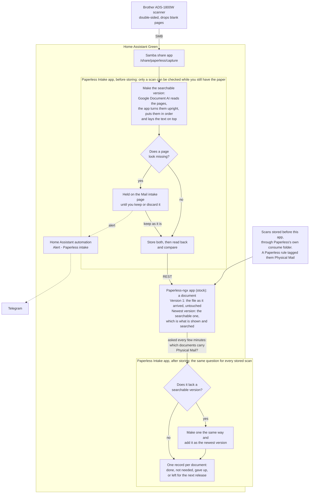

# Paperless Intake

Looks after what comes out of the scanner, and nothing else. Every scan gets an upright, ordered, searchable version in Paperless-ngx, read by Google Document AI. A scan is checked on its way in, while you still have the paper: it is held, with an alert that names the problem, when a page looks missing, the file can't be read, or a day of retries failed. Scans that were stored before this app existed get the same searchable version after the fact.

A stored document is this app's when it carries the `Physical Mail` tag. Every other document in Paperless is left alone. See [Where the app stops](#where-the-app-stops), [DOCS.md](DOCS.md), and [DESIGN.md](DESIGN.md) for why it is built this way.

## How the pieces fit

Solid arrows are the path of a document. Dotted arrows are alerts. A stored scan can also raise an alert, only when something about it needs a look.

The top box is the only place a scan can be checked while you still have the paper. The bottom box finishes the same job for scans that are already stored: the ones from before this app, and any whose searchable version failed the first time. It adds what it makes to the same document. Each document has one owner at a time: a scan belongs to the top box until it has finished going in, and to the bottom box from then on. The app works on one thing at a time, and scans always go first.

Documents that reach Paperless any other way (its web page, the phone app, email) are not in the picture, because the app never looks at them.

## Where the app stops

- **The `Physical Mail` tag is the boundary.** The app puts the tag on every scan it stores. A Paperless rule put it on every scan that came through Paperless's own consume folder before the app. The app takes on a stored document only if it carries the tag.
- **The tag is the only test.** The app never works out from a file's name, its owner or what is inside it whether a document "is really a scan". If a scan is missing the tag, that is a gap on that one document. Add the tag in Paperless and the app takes the document on within minutes. Don't teach the app a second way to recognise scans.
- **Everything without the tag is left alone:** a file added on Paperless's web page, a photo from the phone, an email attachment. The app doesn't fetch it, read it or add to it.
- **Known and accepted for now.** With Paperless's own OCR off, a file with no text inside it that arrives another way has no search text. Those documents can be found in Paperless by the missing tag. Another way in needs its own design before anything reads what it brings.

## Who does what

Paperless-ngx has its own OCR, page rotation and deskew. With Paperless's default settings they still run, but only on the untouched scan. With its OCR mode `off` they don't run at all. This table says whose result you actually see.

| Job | Whose result counts | What Paperless's own feature does |
| --- | --- | --- |
| Keeping the original | For a scan, this app uploads it as version 1 and checks it byte for byte. For a scan stored before this app, version 1 is whatever Paperless was given, and this app never changes it | Stores it unchanged |
| Reading the text (OCR) | Google, through this app | With Paperless's defaults, Tesseract reads version 1 only. That text is superseded as soon as the copy is added. With Paperless's OCR mode `off`, nothing |
| Turning pages upright | This app, once per stack | With Paperless's defaults, rotation and deskew go into Paperless's own archive file of version 1, which is what it then shows as version 1. The copy already has text, so Paperless doesn't OCR it, rotate it or save it again |
| Page order | This app, from the printed page numbers | Nothing |
| Missing-page check | This app. A scan is held for it. For a document that is already stored it goes into the note | Nothing |
| Scans stored before this app | This app asks Paperless every few minutes what it holds, and gives each document that carries `Physical Mail` and has no text inside its file a searchable version. One that already has text is left alone | Nothing. With its OCR mode `off`, Paperless reads nothing itself |
| Documents without the `Physical Mail` tag | Nobody's. This app never looks at them | With its OCR mode `off`, nothing: a file with no text inside it has no search text |
| Search text | Paperless reads it out of the copy with `pdftotext`. This app then compares it with Google's | |
| Document date | This app passes the day of the scan, from the scanner's file name | Not used. Paperless would guess a date from its own reading of version 1 |
| Duplicates | The same file dropped in the scanner's folder twice is stored once. A file that is already in Paperless by another route and then comes through the scanner's folder becomes a second document. The same letter scanned twice is two different files, and this app does nothing about that yet | Paperless 3 stores a file it already holds and flags both on its Duplicates tab |
| Alerts | This app, through a Home Assistant automation | Paperless workflows must not match `Mail intake` documents (see [DOCS.md](DOCS.md)) |

Two Paperless settings keep it this way. Both are in Paperless under Configuration, OCR Settings:

- **Mode** `auto` or `off`. Paperless's documentation says `redo` and `force` OCR every document again, which would replace Google's text in the copy.
- **Archive file generation** `auto` or `never`. With `always`, Paperless makes a PDF/A archive even of a PDF that has text, and shows its own re-saved file in place of the copy.

`auto` and `auto` are Paperless's defaults. `off` and `never` take Paperless out of the reading altogether: it stores and searches what this app gives it, and version 1 is shown exactly as the scanner saved it. The end-to-end tests run both ways, and once against `always` to prove the app notices. The app can't read the settings themselves. After every scan it checks what Paperless did, and the scan's alert says so if the copy got an archive file. See [DOCS.md](DOCS.md).

## Where each part is defined

| Part | Where it lives |
| --- | --- |
| This app's code and image | This folder. CI publishes `ghcr.io/janejeon/paperless-intake` |
| The top box of the picture | `pipeline.py`. One record per scan in `/share/paperless/intake/items/` |
| The bottom box of the picture | `documents.py`. One record per document in `/share/paperless/intake/documents/` |
| Adding a searchable version and reading it back | `searchable.py`, used by both boxes |
| This app's options | The app's Configuration tab in Home Assistant. Secrets are `!secret` references into `secrets.yaml` |
| The alert automation | `JaneJeon/homeassistant-config`, automation `Alert - Paperless intake` |
| The `Physical Mail` tag, and the rule that puts it on files from Paperless's consume folder | Inside Paperless. This app adds the tag to every scan it stores (option `physical_mail_tag`) |
| The capture folder | `/share/paperless/capture`, shared by the Samba app |
| The scanner profile | On the scanner: double-sided, blank pages skipped, saved to the capture share |
| Paperless's OCR settings, tags, workflows and this app's user | Inside Paperless, in its database. Not in any repository |
