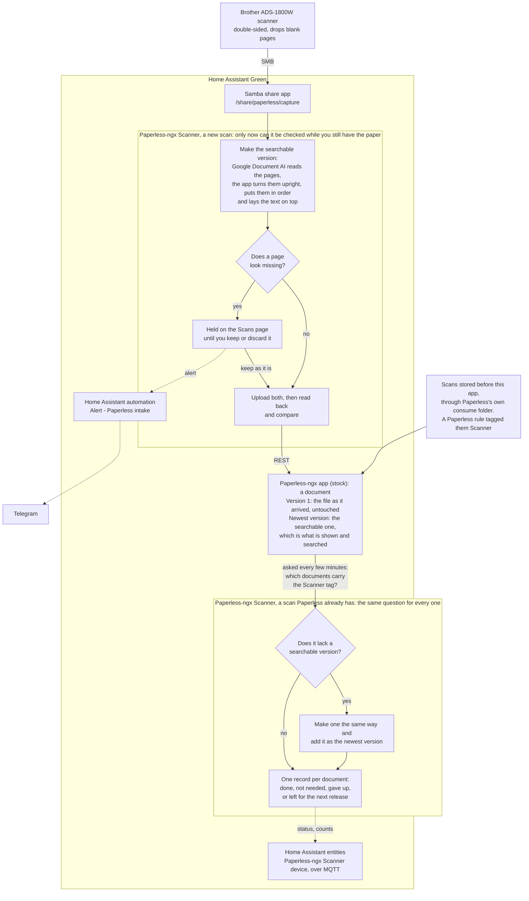

# Paperless-ngx Scanner

Looks after what comes out of the scanner, and nothing else. Every new scan gets an upright, ordered, searchable version in Paperless-ngx, read by Google Document AI. A new scan is checked on its way in, while you still have the paper: it is held, with an alert that names the problem, when a page looks missing, the file can't be read, or a day of retries failed. Scans that were stored before this app existed get the same searchable version after the fact.

The app used to be called Paperless Intake, and its tag used to be called Physical Mail. The slug (`paperless-intake`), the image and this folder keep the old name.

A stored document is this app's when it carries the `Scanner` tag. Every other document in Paperless is left alone. See [Where the app stops](#where-the-app-stops), [DOCS.md](DOCS.md), and [DESIGN.md](DESIGN.md) for why it is built this way.

## How the pieces fit

Solid arrows are the path of a document. Dotted arrows are what Home Assistant is told. A new scan that has just gone in can also raise an alert, a warning, when something about it needs a look (it went in without its searchable version, say). The bottom box never alerts.

The top box is the only place a scan can be checked while you still have the paper. The bottom box finishes the same job for scans Paperless already has: the ones from before this app, and any whose searchable version failed the first time. It adds what it makes to the same document. Each document has one owner at a time: a new scan's document belongs to the top box until the scan has finished going in, and to the bottom box from then on.

The app works on one thing at a time, from a queue kept in its own records: new scans first, then the scans Paperless already has. Before it starts anything it checks that the Green has the memory, the disk space and the disk bandwidth to spare, and that Paperless has finished taking in the last upload. Killed at any moment, it carries every job on from where it stopped when it starts again, and never sends Paperless a file again while it may still be taking that file in. Its own numbers (what it is doing, what is held, Google pages used) are Home Assistant entities. See [DOCS.md](DOCS.md).

Documents that reach Paperless any other way (its web page, the phone app, email) are not in the picture, because the app never looks at them.

## Where the app stops

The document system has five steps: scan, ingest, understand, index and query. This app is the scan step, plus the ingest check for what the scanner produces: paper becomes a trusted file, handed on as the untouched scan plus its searchable version, tagged `Scanner` (under `Source`), and the app reads both back from Paperless to check they arrived whole. The rest of ingest, and understand, index and query, are not this app's job.

- **The `Scanner` tag is the boundary.** It says: this came out of the scanner. The app puts the `Scanner` tag and `Mail Intake` on every scan it uploads. A Paperless rule put `Scanner` on the scans that came through Paperless's own consume folder before the app. The app takes on a stored document only if it carries `Scanner`.
- **The tag is the only test.** The app never works out from a file's name, its owner or what is inside it whether a document "is really a scan". If a scan is missing the tag, that is a gap on that one document. Jane adds the tag in Paperless and the app takes the document on at its next look. Nothing new is started while any document waits for tomorrow's Google pages. Don't teach the app a second way to recognise scans.
- **The tag is checked every time** the app is about to work on a stored document, not only the first time. If the tag has been taken off, the app does nothing to the document and lets it go. If the tag comes back, the app takes the document on again.
- **The app puts `Scanner` (and `Mail Intake`) on the scans it uploads, and never changes a tag on a document already stored.** If you are working on this system and find a scan without the tag, tell Jane. Don't tag documents yourself, and don't give a file the tag to get it read: a tagged file that isn't a PDF is set aside for good and listed on the Scans page.
- **`Mail Intake` marks what this app uploaded.** The app uses it to find its own uploads: a new scan takes for its own only a document that carries it. A Paperless workflow and the Home Assistant watchdog rely on it too: the workflow skips documents with `Mail Intake`, so the watchdog counts each new scan once.
- **Everything without the `Scanner` tag is left alone:** a file added on Paperless's web page, a photo from the phone, an email attachment. The app doesn't fetch it, read it or add to it.
- **Known and accepted for now.** With Paperless's own OCR off, a file with no text inside it that arrives another way has no search text. Those documents can be found in Paperless by the missing tag. Another way in needs its own design before anything reads what it brings.

## Who does what

Paperless-ngx has its own OCR, page rotation and deskew. With Paperless's default settings they still run, but only on the untouched scan. With its OCR mode `off` they don't run at all. This table says whose result you actually see.

| Job | Whose result counts | What Paperless's own feature does |
| --- | --- | --- |
| Keeping the original | For a new scan, this app uploads it as version 1 and checks it byte for byte. For a scan stored before this app, version 1 is whatever Paperless was given, and this app never changes it | Stores it unchanged |
| Reading the text (OCR) | Google, through this app | With Paperless's defaults, Tesseract reads version 1 only. That text is superseded as soon as the searchable version is added. With Paperless's OCR mode `off`, nothing |
| Turning pages upright | This app, once per stack | With Paperless's defaults, rotation and deskew go into Paperless's own archive file of version 1, which is what it then shows as version 1. The searchable version already has text, so Paperless doesn't OCR it, rotate it or save it again |
| Page order | This app, from the printed page numbers | Nothing |
| Missing-page check | This app. A new scan is held for it. For a document that is already stored it goes into the note | Nothing |
| Scans stored before this app | This app asks Paperless every few minutes for the documents that carry `Scanner`, and gives each one that has no text inside its file a searchable version. One that already has text is left alone | Nothing. With its OCR mode `off`, Paperless reads nothing itself |
| Documents without the `Scanner` tag | Nobody's. This app never looks at them | With its OCR mode `off`, nothing: a file with no text inside it has no search text |
| Search text | Paperless reads it out of the searchable version with `pdftotext`. This app then compares it with Google's | |
| Document date | This app passes the day of the scan, from the scanner's file name | Not used. Paperless would guess a date from its own reading of version 1 |
| Duplicates | The same file dropped in the scanner's folder twice is uploaded once. A file that is already in Paperless by another route and then comes through the scanner's folder becomes a second document. The same letter scanned twice is two different files. Telling that two scans are the same letter needs their text, and belongs with understanding documents, not with this app | Paperless 3 takes a file it already holds and flags both on its Duplicates tab |
| Alerts | This app, through a Home Assistant automation | Paperless workflows must not match `Mail Intake` documents (see [DOCS.md](DOCS.md)) |
| The app's own numbers | This app, as entities of the Paperless-ngx Scanner device in Home Assistant, over MQTT | |

Two Paperless settings keep it this way. Both are in Paperless under Configuration, OCR Settings:

- **Mode** `auto` or `off`. Paperless's documentation says `redo` and `force` OCR every document again, which would replace Google's text in the searchable version.
- **Archive file generation** `auto` or `never`. With `always`, Paperless makes a PDF/A archive even of a PDF that has text, and shows its own re-saved file in place of the searchable version.

**This system runs `off` and `never`.** That is Jane's decision: Google is the only reader, with no fallback. The app also works with Paperless's defaults and is tested with them, but with mode `auto` a new scan whose Google reading fails keeps Tesseract's text, which is the fallback she ruled out.

`auto` and `auto` are Paperless's defaults. `off` and `never` take Paperless out of the reading altogether: it stores and searches what this app gives it, and version 1 is shown exactly as the scanner saved it. The end-to-end tests run both ways, and once against `always` to prove the app notices. The app can't read the settings themselves. After every new scan it checks what Paperless did, and the scan's alert says so if the searchable version got an archive file. See [DOCS.md](DOCS.md).

## Where each part is defined

| Part | Where it lives |
| --- | --- |
| This app's code and image | This folder. CI publishes `ghcr.io/janejeon/paperless-intake` |
| Which version is running | Home Assistant, on the app's own page. This repository says what the code does, not what is installed |
| The queue: what runs next, and whether anything may start now | `jobs.py`, with the checks on the Green in `gate.py`. The records below are the queue |
| The top box of the picture | `pipeline.py`. One record per new scan in `/share/paperless/intake/items/` |
| The bottom box of the picture | `documents.py`. One record per document in `/share/paperless/intake/documents/` |
| Adding a searchable version and reading it back | `searchable.py`, used by both boxes |
| The app's numbers in Home Assistant | `entities.py` (what each entity is), `report.py` (its value), `mqtt.py` (publishing) |
| This app's options | The app's Configuration tab in Home Assistant. Secrets are `!secret` references into `secrets.yaml` |
| The alert and watchdog automations | `JaneJeon/homeassistant-config`, automations `Alert - Paperless intake` and `Paperless - Track ...` |
| The `Scanner` tag, and the rule that puts it on files from Paperless's consume folder | Inside Paperless. This app adds the tag to every scan it uploads (option `scanner_tag`) |
| The capture folder | `/share/paperless/capture`, shared by the Samba app |
| The scanner profile | On the scanner: double-sided, blank pages skipped, saved to the capture share |
| Paperless's OCR settings, tags, workflows and this app's user | Inside Paperless, in its database. Not in any repository |
