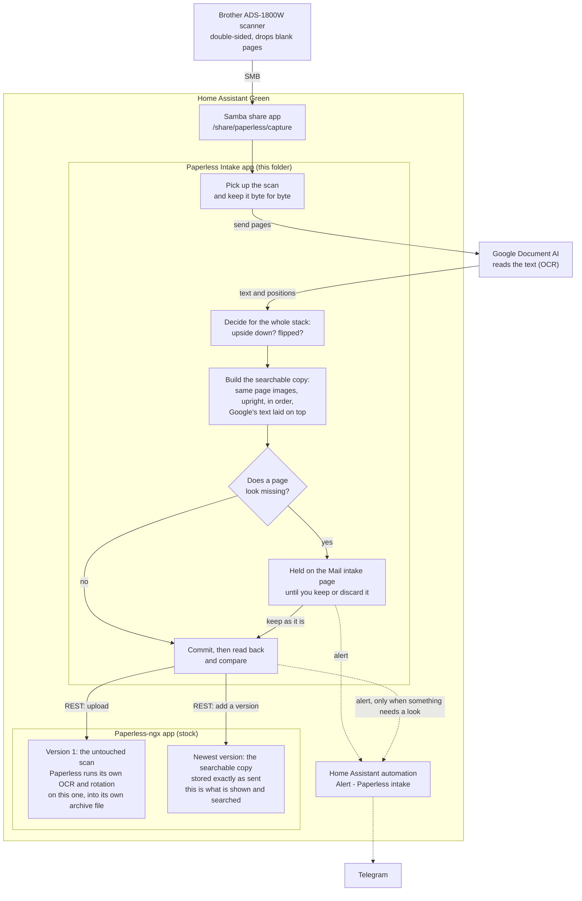

# Paperless Intake

Takes scans from the scanner's folder, makes an upright, ordered, searchable copy with Google Document AI OCR, and commits the untouched scan plus that copy into stock Paperless-ngx through its REST API. A scan is held, with an alert that names the problem, when a page looks missing, the file can't be read, or a day of retries failed. See [DOCS.md](DOCS.md).

## How the pieces fit

Solid arrows are the path of a scan. Dotted arrows are alerts.

## Who does what

Paperless-ngx has its own OCR, page rotation and deskew. They still run, but only on the untouched scan. This table says whose result you actually see.

| Job | Whose result counts | What Paperless's own feature does |
| --- | --- | --- |
| Keeping the original | This app uploads it as version 1 and checks it byte for byte | Stores it unchanged |
| Reading the text (OCR) | Google, through this app | With Paperless's defaults, Tesseract reads version 1 only. That text is superseded as soon as the copy is added. With Paperless's OCR mode `off`, nothing |
| Turning pages upright | This app, once per stack | With Paperless's defaults, rotation and deskew go into Paperless's own archive file of version 1, which is what it then shows as version 1. The copy already has text, so Paperless doesn't OCR it, rotate it or save it again |
| Page order | This app, from the printed page numbers | Nothing |
| Missing-page check | This app | Nothing |
| Search text | Paperless reads it out of the copy with `pdftotext`. This app then compares it with Google's | |
| Document date | This app passes the day of the scan, from the scanner's file name | Not used. Paperless would guess a date from its own reading of version 1 |
| Duplicates | This app asks Paperless for the scan's SHA-256 before it uploads | |
| Alerts | This app, through a Home Assistant automation | Paperless workflows must not match `Mail intake` documents (see [DOCS.md](DOCS.md)) |

Two Paperless settings keep it this way. Both are in Paperless under Configuration, OCR Settings:

- **Mode** `auto` or `off`. Paperless's documentation says `redo` and `force` OCR every document again, which would replace Google's text in the copy.
- **Archive file generation** `auto` or `never`. With `always`, Paperless makes a PDF/A archive even of a PDF that has text, and shows its own re-saved file in place of the copy.

`auto` and `auto` are Paperless's defaults. `off` and `never` take Paperless out of the reading altogether: it stores and searches what this app gives it, and version 1 is shown exactly as the scanner saved it. The end-to-end tests run both ways, and once against `always` to prove the app notices. The app can't read the settings themselves. After every scan it checks what Paperless did, and the scan's alert says so if the copy got an archive file. See [DOCS.md](DOCS.md).

## Where each part is defined

| Part | Where it lives |
| --- | --- |
| This app's code and image | This folder. CI publishes `ghcr.io/janejeon/paperless-intake` |
| This app's options | The app's Configuration tab in Home Assistant. Secrets are `!secret` references into `secrets.yaml` |
| The alert automation | `JaneJeon/homeassistant-config`, automation `Alert - Paperless intake` |
| The capture folder | `/share/paperless/capture`, shared by the Samba app |
| The scanner profile | On the scanner: double-sided, blank pages skipped, saved to the capture share |
| Paperless's OCR settings, tags, workflows and this app's user | Inside Paperless, in its database. Not in any repository |
